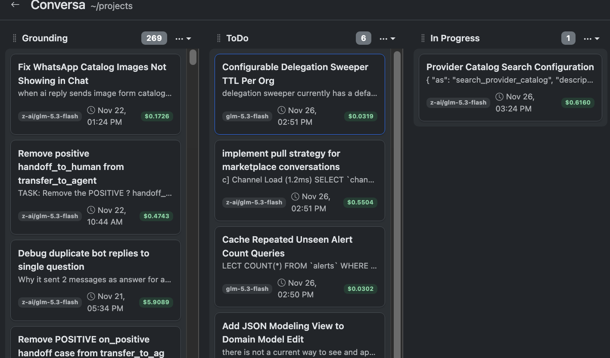
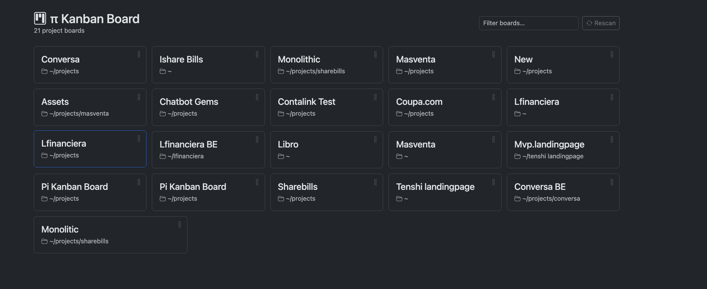

# π Kanban Board

A self-contained Trello-style kanban board for **pi coding-agent sessions**.

## Why this exists

Every time I start a new pi conversation it begins with an idea which quickly
grows up, sometimes with details I am not able to remember — losing context,
attachments, descriptions. One week later I am not even able to remember which
decisions I took. This is why I organize my work in a different way, using a
customizable kanban board: I can observe my process on each conversation, its
highlights and insights, and the conclusions I took deliberately — instead of
digging through a pile of `.jsonl` files.

## What it is.

It is a **local, single-user tool**. It reads pi's session files
(`~/.pi/agent/sessions/**.jsonl`) and shows them as cards on boards, so you can
see, group, annotate and revisit your work. It does **not** send anything
anywhere, has **no authentication**, and is meant to run on your machine or
your server, exposed only to you.





Features:

- **One board per project directory** — auto-detected from the sessions tree;
  empty directories don't create boards. Names are humanized
  (`conversa_be` → "Conversa BE", with a muted path subtitle for context).
- **Scrum-friendly default columns** — Grounding / In Progress / QA /
  Deployed / Done — fully customizable: add, rename, reorder, delete
  (deleting a column returns its cards to the first remaining column).
- **Drag & drop** with persistence across restarts, plus per-column ordering.
- **Sort** each board by `created_at` or `updated_at` (asc/desc), persisted.
- **Search** across session names and first-prompt previews.
- **Live updates** — new sessions appear on the board within seconds
  (polling file watcher, needed for Docker mounts; no refresh needed).
- **Card annotations** (click a card):
  - a **description** per session — the conclusion you want to remember,
  - **comments** on a timeline, editable,
  - **file attachments**, downloadable, stored under `data/attachments/`.
- **Visual conversation navigator** — a modal that renders the session's
  message tree far better than the TUI `/tree`: chat bubbles with model /
  tokens / cost / timestamps, collapsed tool calls, **branch chips** to switch
  between alternatives at every branch point, the session's **active branch
  highlighted**, an outline of all prompts for one-click jumping, and a copy
  button for `pi --session <id>`.

## Architecture

Deliberately boring, in one container:

```
backend/    Rails 8 JSON API (SQLite, ActionCable), SessionScanner + Watcher
frontend/   React 19 + Vite + Bootstrap 5 SPA (react-bootstrap, @hello-pangea/dnd)
data/       SQLite database + uploaded attachments (volume)
```

- The backend watches `SESSIONS_ROOT` with the `listen` gem in **polling
  mode** (inotify events don't cross Docker mounts), parses session JSONL
  incrementally, and notifies open boards over ActionCable.
- The SPA is built into the Rails `public/` dir by the Dockerfile; Rails
  serves it with a catch-all fallback for client-side routes.
- Session metadata (name, preview, model, tokens, cost) comes from the JSONL
  itself; the board never modifies pi's files (mounted read-only).

## Run it

```bash
docker compose up --build -d
# → http://localhost:3049
```

Sessions root defaults to `/sessions` inside the container, mounted read-only
from `~/.pi/agent/sessions`. Everything persists in `./data/`.

## Development

```bash
cd backend  && bundle install && rails db:prepare && rails s -p 3049
cd frontend && npm install && npm run dev      # Vite on :5199, proxies /api + /cable
```

Tests (backend, RSpec):

```bash
cd backend && bundle exec rspec
```

## Limitations

- One user, no auth — don't expose it publicly.
- Watcher latency is ~2s (polling); a missed update is fixed by "Rescan".
- Conversation rendering truncates very long messages (6k chars) and tool
  arguments (200 chars) to keep the DOM sane.
- Attachments are files you upload to the board — it does not extract
  attachments from inside pi sessions.
